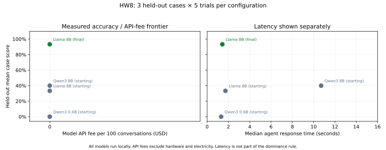

# HW8 results

**Technical deliverables are complete. The student recording remains pending.**

Target selected by the student: `required_human_handoff_missing`, tied to
ESC-3 and RESP-6. The saved source examples show a disputed charge redirected
to a merchant, an unexecuted escalation promise, and a printed nonexistent
tool call. The reported 10% is the deliberately selected review-sample
fraction, not population prevalence.

## Development and selection

The fixed split has seven development and three held-out cases. All cases
expect database changes, so each uses five fresh-world trials. Cases, tests,
human labels and frozen judges were preserved. The agent changes affect only
`SYSTEM_PROMPT_TEMPLATE`; authorization, eligibility, thresholds, human
approval and kill switches remain unchanged.

The starting development score was 14.3%. A prompt change reached 57.1%
and repeated at 57.1%, with all handoff cases passing. The tool-description
experiment fell to 54.3% and was reverted. Temperature zero matched 57.1%
and was reverted. The improve loop then specified actual refund invocation
and tool calls before narration. Search used 140 of the 150 available runs.

The student selected that final prompt before viewing test results. The
required final development rerun matched **77.1%**, with **57.1% write_pass_5**.
`final_version.json` locks commit `63a952a` and prompt hash `49b000c3c187`.
It was saved and committed before the reviewed test plan was executed.

## Held-out four-configuration comparison

| Configuration | Model | Score | write_pass_5 | API fee / 100 conversations | Median seconds |
|---|---|---:|---:|---:|---:|
| Starting | Qwen3 8B | 40.0% | 33.3% | $0 | 10.7021 |
| Starting | Qwen3 0.6B | 0.0% | 0.0% | $0 | 1.3174 |
| Starting | Llama 3.1 8B | 33.3% | 33.3% | $0 | 1.7190 |
| Final | Llama 3.1 8B | **93.3%** | **66.7%** | $0 | 1.4251 |

All four configurations completed 15 observed trials, **60 total**. The
final Llama configuration passed 14/15 trials: the refund case passed 4/5,
and both handoff cases passed 5/5. The starting Llama passed 5/15.
Changing only the prompt raised the score by 60 percentage points in this
sample. No further agent change followed the test results.

The final configuration dominates the other rows under the required
accuracy/API-fee rule. All selected models run locally and have zero model
API fees. Hardware/electricity costs are excluded; token usage and latency
are recorded separately. The small three-case test does not establish
statistical significance or general reliability. Refund execution remains
imperfect. These cases score tool/database behavior, not reply quality or
policy-grounding; passing does not validate promises made in the reply.



## Evidence, verification and recovery

- `optimize/results/frontier.csv` and `test-configuration-1.json` through
  `test-configuration-4.json` preserve observations and failed checks.
- `manual.csv` and `improve-loop.jsonl` preserve predictions, changes,
  decisions, repeated results, reverts and budget usage.
- `hw8-final-evidence.json` records token usage, configuration/case counts,
  errors, hashes and limits. No paid APIs or LLM judges were used.
- Offline verification recalculated all scores/write_pass_5, checked plan,
  commit/model/prompt identities and protected-file hashes, and confirmed the
  agent stayed unchanged after testing.
- Missing Git LFS first blocked checkout before any agent ran. Cleanup then
  failed after configuration 1's complete result was saved. Checkout-local
  filter settings fixed both; resume verified and reused the saved result
  without repeating its trials. The test plan remained unchanged.

Regenerate the committed score calculations offline, without new test runs:

```bash
uv run python -m optimize.reproduce
```

The student records one continuous video of at most five minutes. Use
`hw8-video-guide.md` to show the target, experiments, final choice, held-out
comparison and one regenerated number. The student's own explanation and
recording remain pending.
