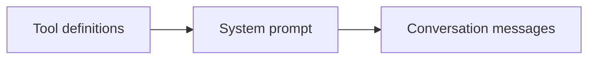

# HW9 Part C: OpenAI caching comparison (skipped at student request)

The handout requires a live OpenAI model for this measurement. Ollama's
reported cached usage does not verify OpenAI prompt caching. The student
withdrew paid-run authorization before any API call and requested that all
checks costing money be skipped. No OpenAI request was made. The following
is an unrun plan, not an active task or evidence of caching.

Request prefix order:

The injected session context near the beginning of the system prompt varies
by user. Moving that entire block to the end, with identical wording, extends
the shared prefix. The shared prefix must still reach the provider's minimum
length and remain cached between requests to produce a measured hit.

After paid-run approval and provider compatibility verification:

1. Add verified current input, cached input and output prices for the selected
   OpenAI model to `optimize/config.json`.
2. Make one policy request with `agent.cli --debug` and confirm a tool call.
3. Run `optimize.runner --split development --candidate cache-before` with
   `--output optimize/results/development-hw9-cache-before.json`.
4. Move only the session context block to the end, commit, and run
   `cache-after` with the same model and cases, writing
   `optimize/results/development-hw9-cache-after.json`.
5. Compare score, write_pass_5, cached fraction, tokens, cost and latency.
   Keep the new order only if the development score did not fall.

Planned full comparison: 70 evaluated case runs (35 per configuration),
zero judge calls, plus one compatibility conversation. Each evaluated run
may make multiple model requests. A monetary estimate and chosen model must
be shown before approval; this document grants no paid-run permission.

The active prompt has not been reordered because the before/after
measurements were skipped. An unrun comparison has no score, cost or cached fraction.
