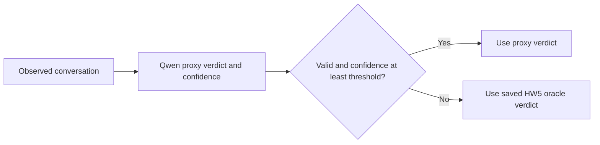

# HW9 Part D: local judge cascade

Oracle: the frozen, student-selected `unsupported_policy_claim-v2`, Llama
3.1 8B. Use its saved verdicts; make no new oracle requests.

Proxy proposal: local Qwen3 0.6B. It has fewer model parameters than the
oracle, although both have zero API fees. This is a resource-cost experiment;
it does not establish savings in dollars or fulfill the handout's expectation
of differing model API prices. Hardware and electricity are not priced.

The proxy gets the exact HW5 judge prompt and observed conversation, plus
the confidence instruction. Human labels and oracle verdicts never enter
the request. API input/output tokens, confidence and latency are saved.
Invalid structured output always falls back to the saved oracle verdict.

Agreement requirement: **95%**, set by the agent as a stated assumption
before proxy runs or threshold calculations; student confirmation remains pending. There are 38 development and 38 test labels. At 95%,
at most one disagreement passes: 37/38 = 97.37%; 36/38 = 94.74% fails.

After that decision, save the requirement and threshold grid to
`cascade/results/config.json` before running the proxy. Sweep development
thresholds only. Select the lowest threshold that meets the requirement,
save it before the test run, then check it once on the test labels.
No threshold adjustment after viewing test results.

The student's HW5 deployment assessment prohibits automatic decisions.
The cascade inherits that restriction even if it agrees perfectly with
the oracle. Report both oracle and human agreement and disagreement counts.
